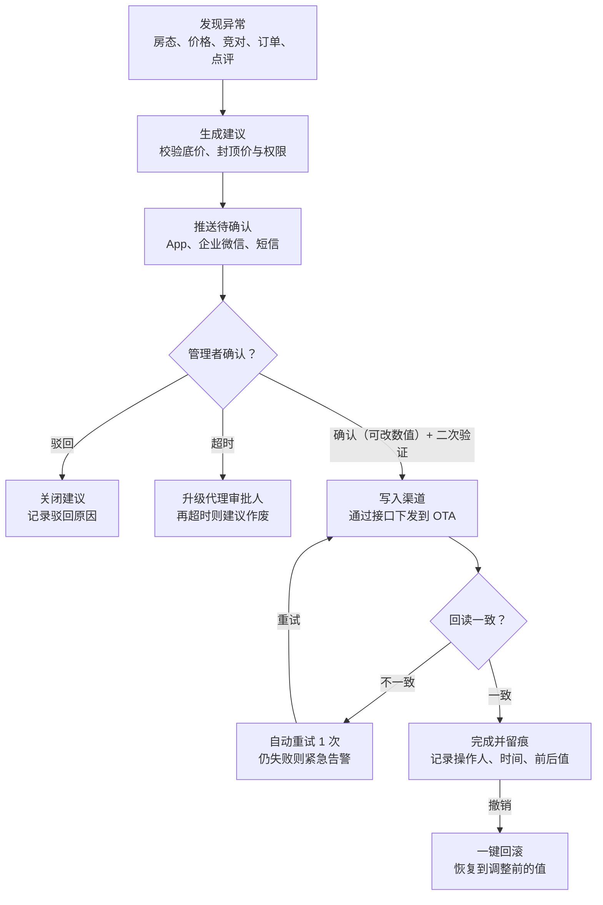

# 酒店OTA 24小时盯盘系统需求文档

2026-10-27

> 在线版（可编辑、可评论）：https://claude.ai/artifact/PEKcm9W7AmRRSgFdc62rU3

## 1. 项目背景与目标

系统要做到 7×24 小时自动盯住各 OTA 渠道的房态、价格、订单和评价，发现问题马上告警，并生成调价或上下架建议；**任何改动线上房态或价格的操作，都必须由管理者确认后才能执行（唯一例外：超售风险下的紧急关房）。**

**当前痛点**

- 夜间和节假日没人盯盘，满房后没及时关房，导致超售；空房多时也没及时开房或降价，造成空置。
- 各渠道价格不一致，被 OTA 判定为价格倒挂而降权，或者被协议客户投诉。
- 竞争对手调价后，我们要隔几个小时甚至第二天才知道。
- 差评、未确认订单、渠道连接中断这类问题发现得晚，处理不及时。

**业务目标（上线 3 个月后衡量）**

| 指标 | 目标 |
| --- | --- |
| 超售/超订次数 | 降至 0 |
| 渠道间价格不一致的发现时间 | ≤ 15 分钟 |
| 竞对调价的感知时间 | ≤ 30 分钟 |
| 新差评的首次响应时间 | ≤ 2 小时 |
| 夜间（23:00–08:00）异常处理率 | ≥ 95% |

**核心原则**

1. **人工把关**：系统只负责监控、分析和提建议；开房、关房、上架、下架、调价全部要管理者一键确认后才执行；唯一例外是超售风险下的紧急关房（见第 5 节），开房、上架、调价永远不会自动执行。
2. **可追溯**：每条建议、每次确认和执行结果都留存记录，可以回滚。
3. **少打扰**：告警分级处理，只有真正紧急的事才在夜间打电话叫人。

## 2. 用户角色与权限

只有“管理者”和被授权的“收益经理”能确认上架与调价，其他角色只能查看和处理各自负责的告警。

| 角色 | 典型人员 | 查看监控 | 处理告警 | 确认上架/调价 | 配置规则 |
| --- | --- | --- | --- | --- | --- |
| 管理者 | 店长/酒店负责人 | 全部 | 全部 | 可以，无限额 | 可以 |
| 收益经理 | 收益/销售主管 | 全部 | 全部 | 可以，受限额约束（如单次调价 ≤ ±15%） | 部分 |
| 前台值班 | 前台/夜审 | 房态、订单 | 订单类、房态核对 | 不可以（只能发起申请） | 不可以 |
| 客服/点评专员 | 客关 | 评价 | 评价类 | 不可以 | 不可以 |
| 只读/老板 | 投资人、区域经理 | 看板与报表 | 不可以 | 不可以 | 不可以 |

- 权限可以按门店、按渠道单独配置（多门店场景）。
- 管理者可以设置“代理审批人”，在休假或夜间时段把确认权临时交给指定人员。
- 登录需要手机验证码或企业微信/钉钉身份；确认上架时需要二次验证（密码或指纹）。

## 3. 系统范围与对接

一期覆盖国内 4 大 OTA 和酒店现用的选住云管家 PMS，优先通过官方接口或渠道管理器（Channel Manager）对接；竞对公开价格采用合规的数据服务获取。

**当前阶段**：先不接入真实数据。系统按“数据适配器”搭框架，PMS、每个 OTA、竞对数据、通知通道各一个适配器，现在全部用模拟数据；以后逐个换成真实接口，上层的监控规则、告警和确认流程不用改。

| 对接对象 | 优先级 | 读取内容 | 写入内容（须人工确认） | 对接方式 |
| --- | --- | --- | --- | --- |
| 携程（含去哪儿） | 一期 | 房态、房价、订单、点评、排名 | 开/关房、房量、价格 | 直连接口或渠道管理器 |
| 美团 | 一期 | 同上 | 同上 | 直连接口或渠道管理器 |
| 飞猪 | 一期 | 同上 | 同上 | 直连接口或渠道管理器 |
| 抖音/小红书酒店商品 | 二期 | 订单、库存 | 商品上下架 | 开放平台接口 |
| Booking / Agoda / Expedia | 二期（有外宾时） | 房态、房价、订单、评分 | 开/关房、价格 | 渠道管理器 |
| 酒店 PMS | 一期 | 实时可售房、在住、维修房、门市价 | 不写入 | 选住云管家接口（现阶段用模拟数据） |
| 竞对酒店公开价 | 一期 | 价格、是否满房、评分 | — | 第三方数据服务 |

**不在本期范围内**：自动代为回复点评、OTA 广告投放、财务对账结算。

**合规提示**：不使用违反 OTA 用户协议的爬虫或模拟登录方式操作商家后台，避免封号风险。

## 4. 功能需求

系统由 6 个监控模块和 1 个建议引擎组成；监控模块只读不写，所有写入动作统一由建议引擎生成、经第 5 节的确认流程执行。优先级：P0 = 一期必须，P1 = 一期应有，P2 = 二期。

### 4.1 房态房量监控

| 编号 | 需求 | 优先级 |
| --- | --- | --- |
| F-101 | 每 5 分钟比对 PMS 可售房与各渠道在售房量，按房型、按日期（未来 90 天）展示 | P0 |
| F-102 | 渠道在售房量 ＞ PMS 可售房时触发“超售风险”紧急告警，并生成“关房/减房量”建议；超时无人确认时按第 5 节紧急关房 | P0 |
| F-103 | PMS 有空房但渠道已关房时提示“漏开房”，生成“开房”建议 | P0 |
| F-104 | 当日入住率达到阈值（默认 90%）时提醒保留房或收紧房量 | P1 |
| F-105 | 维修房/停用房变化后自动重算可售房 | P1 |

### 4.2 价格监控

| 编号 | 需求 | 优先级 |
| --- | --- | --- |
| F-201 | 每 15 分钟抓取各渠道前台展示价（含优惠后到手价），与价格策略比对 | P0 |
| F-202 | 渠道间价差超过阈值（默认 ±3% 或 ¥10）时告警“价格不一致/倒挂” | P0 |
| F-203 | 发现异常低价（低于底价）或异常高价（误操作，如少写一个 0）时紧急告警 | P0 |
| F-204 | 识别 OTA 平台自身的补贴/促销导致的价差，与酒店侧问题区分展示 | P1 |

### 4.3 竞对监控

| 编号 | 需求 | 优先级 |
| --- | --- | --- |
| F-301 | 可配置 5–10 家竞对酒店，按房型映射，每 30 分钟更新价格与满房状态 | P0 |
| F-302 | 竞对调价幅度超过阈值（默认 10%）或竞对大面积满房时提醒，并生成调价建议 | P0 |
| F-303 | 展示本店在商圈内的价格排位、评分排位和搜索排名变化趋势 | P1 |

### 4.4 订单监控

| 编号 | 需求 | 优先级 |
| --- | --- | --- |
| F-401 | 新订单实时推送；超过 N 分钟（默认 10 分钟）未确认的订单升级告警，避免被 OTA 罚款 | P0 |
| F-402 | 订单未同步进 PMS、取消单、修改单、重复单提醒 | P0 |
| F-403 | 预订量突增/突降（与同期相比超过 30%）提醒，可触发调价建议 | P1 |

### 4.5 评价与口碑监控

| 编号 | 需求 | 优先级 |
| --- | --- | --- |
| F-501 | 各渠道新点评 30 分钟内汇总；差评（≤ 3 分或含敏感词如“蟑螂”“不干净”“起争执”）重要告警 | P0 |
| F-502 | 由 AI 生成回复草稿，员工修改后人工发出 | P1 |
| F-503 | 评分变化趋势与高频问题词云，按周汇总 | P2 |

### 4.6 渠道健康监控

| 编号 | 需求 | 优先级 |
| --- | --- | --- |
| F-601 | 监测各渠道接口连通性，连续 3 次失败即告警“渠道断连” | P0 |
| F-602 | 房型/价格计划被 OTA 侧下线、商家账号异常、违规提醒等通知统一汇总 | P1 |

### 4.7 建议引擎

| 编号 | 需求 | 优先级 |
| --- | --- | --- |
| F-701 | 根据规则（入住率、提前预订天数、竞对价、节假日日历）生成“开房/关房/调房量/调价/上架/下架”建议 | P0 |
| F-702 | 每条建议必须写明：动作、涉及渠道/房型/日期、调整前后的值、触发原因、预估影响 | P0 |
| F-703 | 价格护栏：建议价格必须在管理者设定的底价与封顶价之间，超出则不生成 | P0 |
| F-704 | 同一房型同一日期的多条建议自动合并，避免重复推送 | P1 |
| F-705 | 根据历史数据的需求预测与动态定价模型 | P2 |

## 5. 人工确认上架流程

系统生成的每一条写入动作，只有在管理者确认并通过二次验证后才会下发到 OTA；未确认的建议不会自动执行，唯一例外是下面的紧急关房。

驳回和超时都不会改动线上数据；写入后系统会回读渠道数据核对，不一致就重试并告警。

**确认方式**

- 手机 App 或企业微信/钉钉卡片上一键“确认 / 修改后确认 / 驳回”，卡片上直接展示调整前后对比和触发原因。
- 支持批量确认（如“五一期间 5 个房型全部上调 8%”），但批量操作只能由管理者本人确认。
- 管理者也可以不等建议，直接在系统内发起调价/上下架，同样走二次验证和回读核对。

**超时规则（按紧急程度）**

| 建议类型 | 等待管理者 | 超时后 | 再超时后 |
| --- | --- | --- | --- |
| 紧急：超售风险关房、异常低价 | 10 分钟 | 电话通知代理审批人，再等 10 分钟 | 超售风险：自动关房并立即通知；异常价格：持续电话提醒，不自动执行 |
| 重要：竞对调价应对、开房 | 60 分钟 | 推送代理审批人 | 4 小时后建议作废 |
| 普通：常规调价、房型上架 | 当日 | 进入次日待办 | 48 小时后作废 |

**紧急关房例外**：超售风险连续 20 分钟无人确认时，系统只对涉及的房型和日期自动关房，并立即电话和推送告知管理者，管理者可一键重新开房。这是唯一的自动写入，只关不开、不改价格，默认开启，可在设置中关闭。

**回滚**：每次执行保存调整前的快照，72 小时内可一键恢复；回滚本身也需要确认并留痕。

## 6. 告警与通知

告警分 3 级，只有“紧急”级会在夜间打电话叫醒值守人，其余在静默时段（默认 23:00–07:00）累积到早上统一推送。

| 级别 | 典型场景 | 通知方式 | 响应时限 | 未响应升级 |
| --- | --- | --- | --- | --- |
| 紧急 | 超售风险、异常低价/高价、渠道断连、订单超时未确认 | 电话 + App 强提醒 + 企业微信/钉钉 | 10 分钟 | 依次电话值班前台 → 代理审批人 → 管理者 |
| 重要 | 价格不一致、竞对大幅调价、差评、漏开房 | App 推送 + 企业微信/钉钉 | 60 分钟 | 推送代理审批人 |
| 提示 | 预订量波动、排名变化、普通好评 | App 消息中心，进入早报 | 当日 | 不升级 |

- **值守排班**：支持按周排班，告警先发给当班人；排班为空时默认发给管理者。
- **告警去重**：同一问题 30 分钟内只通知一次，问题恢复后自动发送“已恢复”通知。
- **闭环**：每条告警都要有人标记“已处理 / 忽略（需填原因）”，统计处理时长。
- **阈值可调**：所有阈值（价差、入住率、超时分钟数等）由管理者在设置页修改，修改留痕。

## 7. 看板与报表

首页是一块“实时盯盘大屏”，打开就能看到待确认建议和未处理告警；另有早报、周报和操作审计报表。

**实时盯盘大屏（PC + 手机）**

- 顶部：待确认建议数、未处理告警数（按级别）、各渠道连接状态。
- 房态日历：房型 × 未来 30 天，每格显示可售房、各渠道开关状态和价格，异常格子标红。
- 价格对比：本店各渠道价 vs 竞对价走势线。
- 今日经营：入住率、ADR（平均房价）、RevPAR（每间可售房收入）、各渠道订单占比。

**定期报表**

| 报表 | 推送时间 | 主要内容 |
| --- | --- | --- |
| 早报 | 每天 08:00 | 夜间告警与处理情况、待确认建议、今日预测入住率、竞对价格变化 |
| 周报 | 每周一 09:00 | 各渠道产量、ADR/RevPAR 趋势、建议采纳率与效果、评分变化 |
| 操作审计 | 随时查询 | 谁在什么时间确认/驳回了哪条建议，调整前后的值，执行结果 |

报表支持导出 Excel。

## 8. 非功能需求

系统必须比人更可靠：可用性不低于 99.9%，系统自身出故障时也要有人收到告警。

| 类别 | 要求 |
| --- | --- |
| 可用性 | 7×24 运行，月可用率 ≥ 99.9%（每月停机 ≤ 44 分钟）；云端多可用区部署 |
| 自监控 | 系统自身心跳中断 5 分钟即通过独立通道（短信/电话）告知管理者“盯盘系统离线” |
| 时效 | 房态异常 ≤ 5 分钟发现；紧急告警从发现到推送 ≤ 1 分钟；确认后写入渠道 ≤ 2 分钟 |
| 安全 | HTTPS 加密；OTA 账号和接口密钥加密存储，员工不可见；确认上架需二次验证 |
| 审计 | 所有建议、确认、执行、回滚、规则修改记录保存 ≥ 1 年，不可删除 |
| 数据合规 | 客人姓名、手机号等个人信息脱敏展示，符合《个人信息保护法》；数据存储在境内 |
| 易用性 | 手机端优先，确认一条建议 ≤ 3 步操作；界面中文 |
| 扩展性 | 支持从单店扩展到多门店；新增渠道不影响现有功能 |

## 9. 验收标准、里程碑与默认假设

一期在约 12 周内上线，以“试运行 30 天零超售、零未经确认的开房、上架和调价”作为最终验收门槛。

**验收标准**

- [ ] 未经确认的建议在任何情况下（含超时、系统重启）都不会写入 OTA（紧急关房除外），由测试用例覆盖
- [ ] 模拟超售、价格倒挂、渠道断连、订单超时 4 类场景，均在第 8 节规定的时限内告警
- [ ] 确认后 2 分钟内写入渠道并回读一致，成功率 ≥ 99%
- [ ] 回滚功能可将价格和房态恢复到调整前
- [ ] 审计日志能查到每次操作的操作人、时间、前后值
- [ ] 试运行 30 天内超售 0 次

**里程碑（以启动周为第 1 周）**

1. 第 1–2 周：用模拟数据搭好系统框架（看板、告警、确认流程），同时确定渠道对接方式与供应商
2. 第 3–7 周：房态、价格、订单监控 + 告警 + 人工确认流程（全部 P0）
3. 第 8–9 周：竞对、评价、渠道健康监控，看板与早报
4. 第 10–12 周：只读试运行 2 周（只告警不写入），再开启确认写入
5. 上线后 30 天：正式验收，启动二期（P2 需求与海外渠道）

**默认假设（可随时修改）**

PMS 已确认是选住云管家，其余各项先按下面的假设推进，上线前逐项核实。

| 事项 | 默认做法 | 上线前需核实 |
| --- | --- | --- |
| PMS | 选住云管家（已确认） | 选住云管家是否开放实时房态、订单接口及费用；不开放则改由渠道管理器同步 |
| 酒店规模 | 按单店设计，系统架构支持多门店 | 实际房间数与房型数 |
| OTA 对接 | 先通过一个渠道管理器统一对接各 OTA，已开通直连的渠道再切直连 | 各 OTA 直连开通情况 |
| 竞对名单 | 系统推荐同商圈 3 公里内、价位相近的 8 家，管理者勾选 | 最终名单与房型对应关系 |
| 底价/封顶价 | 底价 = 近 90 天该房型最低成交价的 90%，封顶价 = 门市价 | 管理者逐个房型确认 |
| 夜间值守 | 告警先发值班前台（夜审），代理审批人为收益经理；无此岗位则为管理者本人 | 排班表 |
| 紧急关房例外 | 默认开启（见第 5 节） | 管理者确认是否保留 |
| 建设方式 | 采购成熟的盯盘/收益管理 SaaS，再定制确认流程与告警，比自建上线快 | 比较 2–3 家供应商报价，以及是否支持选住云管家 |
